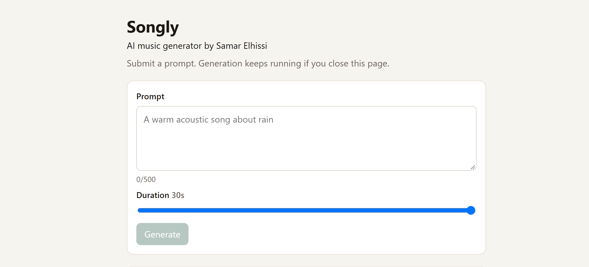
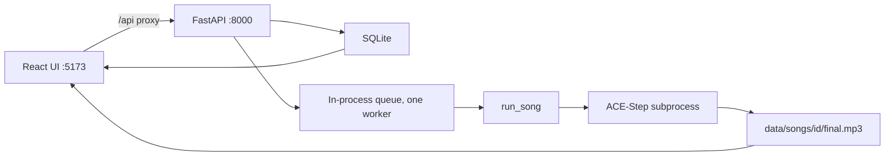

# Songly

[](LICENSE)
[](https://www.python.org/downloads/)
[](https://nodejs.org/)

AI music generator by Samar Elhissi

Local web app that turns a text prompt into a short song with vocals and keeps the result after you close the tab.

## Why I built this

I enjoy playing my acoustic guitar, singing and working with AI, and Songly combines both music and AI. It started as a Streamlit prototype that stitched together MusicGen, GPT-2 and text-to-speech, but the vocals never sounded like singing. I rebuilt it as a full-stack app with background jobs and switched to ACE-Step, which generates the vocals and the music together.
The vocal part was the most challenging in the project, and I'm happy that I used ACE-Step in the end.

## Demo



| Prompt | Audio |
| --- | --- |
| a warm acoustic song about rain | [sample 1](assets/rain.mp3) |
| a sad song about a breakup with the girl i love | [sample 2](assets/breakup.mp3) |
| a deep warm song about the person i love | [sample 3](assets/love.mp3) |

## What it does

- Submit a prompt (3–500 characters) and a duration (form slider 10–30s, default 30).
- The API returns a song id immediately (202). The card polls until `completed` or `failed`.
- Closing the tab is safe; the list reloads from the server next time.
- A finished song shows lyrics, tempo when ACE-Step returned one, and the final mix player.
- Delete removes the DB row and `data/songs/{id}/`. Failed jobs show one error sentence (no stack trace).

## How it works



Vite proxies `/api` to `127.0.0.1:8000`. One background thread runs songs. On the default path the worker starts `.venv-acestep`, runs `acestep_worker.py`, plans lyrics with `acestep-5Hz-lm-0.6B`, renders with `acestep-v15-turbo`, and saves `final.mp3`. Durations under 10s are raised to 10 for ACE-Step; the API still clamps to `MIN`–`MAX` (5–30 by default).

Older instrumental/lyrics/vocals/mixer details: [docs/ARCHITECTURE.md](docs/ARCHITECTURE.md).

## Key design decisions

- Create returns before generation; the UI polls `GET /api/songs/{id}` every 2s until finished.
- SQLite plus files under `data/songs/{id}/` survive restarts. Running statuses become failed with "Interrupted by server restart"; `queued` jobs are re-enqueued.
- Pipeline slots are chosen by name in config; tests use `fake` and do not download weights.
- ACE-Step runs in a fresh process per song (weights reload each time). The ACE path records only `generating_music` in `step_timings`.

## Try it in two minutes (no GPU, no model downloads)

```powershell
python -m venv .venv
.venv\Scripts\python -m pip install -r backend\requirements.txt
copy .env.example .env
```

In `.env` set every generator to `fake`:

```text
SONGCRAFT_MUSIC_GENERATOR=fake
SONGCRAFT_LYRICS_GENERATOR=fake
SONGCRAFT_VOCAL_SYNTHESIZER=fake
SONGCRAFT_MIXER=fake
SONGCRAFT_BEAT_ANALYZER=fake
```

```powershell
cd frontend
npm install
cd ..
.venv\Scripts\python -m uvicorn songcraft.main:app --reload --app-dir backend --host 127.0.0.1 --port 8000
```

In a second terminal:

```powershell
cd frontend
npm run dev
```

Open `http://localhost:5173`. Submit a prompt. You should see a card move through steps and finish with playable audio (silent/fake bytes) and placeholder lyrics. No Hugging Face or ACE-Step download.

Equivalent Make targets (if `make` is on PATH): `make backend`, `make frontend`, `make test`.

## Run it with real models (ACE-Step)

Prerequisites: Python 3.11 or 3.12 for ACE-Step (`ace-step/pyproject.toml` requires `>=3.11,<3.13`), Node/npm for the frontend, a CUDA GPU recommended (ACE-Step also documents CPU/MPS; Songly’s worker currently passes `cuda` when `SONGCRAFT_DEVICE=auto`).

```powershell
make setup
# or: powershell -NoProfile -ExecutionPolicy Bypass -File scripts/setup_acestep.ps1
copy .env.example .env
# leave SONGCRAFT_MUSIC_GENERATOR=acestep
.venv\Scripts\python -m pip install -r backend\requirements.txt
cd frontend; npm install; cd ..
.venv\Scripts\python -m uvicorn songcraft.main:app --reload --app-dir backend --host 127.0.0.1 --port 8000
```

First real song downloads weights into `ace-step/checkpoints` (gitignored).

Tested on: Windows 11, RTX 4060, Python 3.11, Node 24  
macOS and Linux ACE-Step installs via this repo’s setup script are untested here (script is PowerShell).

## Results

| | |
| --- | --- |
| Generation time per song | ~120–180 s for 30 s song |
| Hardware | Windows 11, RTX 4060 |

## Limitations

- No authentication.
- One in-process worker; a second song waits. Mid-run process kill → failed, not resumed.
- ACE-Step reloads weights every song. UI still lists five older steps while status stays on `generating_music`.
- No `instrumental.wav` on the ACE path. Planner lyrics may ignore parts of the prompt.
- ACE-Step mp3 export needs `ffmpeg` on PATH for the worker’s AudioSaver.

## Roadmap

- Single “Generating” step in the UI for ACE-Step.
- Keep the ACE-Step process warm between songs.
- Optional form field to pass lyrics through instead of the planner.
- Non-Windows setup script if needed.

## Credits and licenses

Songly is MIT ([LICENSE](LICENSE)).

[ACE-Step 1.5](https://github.com/ACE-Step/ACE-Step-1.5) code is MIT (`ace-step/LICENSE`). The Hugging Face model card for the weights used here also lists **MIT** (`ace-step/checkpoints/README.md` after download).

Archived AudioCraft under `legacy/audiocraft/` is not used by the running app. Meta’s `facebook/musicgen-small` weights are CC-BY-NC 4.0 if you use that archive yourself.

## Docs

- [docs/CONFIG.md](docs/CONFIG.md) — environment variables  
- [docs/ARCHITECTURE.md](docs/ARCHITECTURE.md) — ACE-Step vs older pipeline, swap points  
