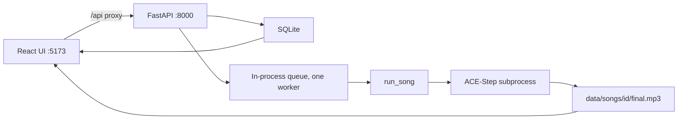

# Architecture

## Default path: ACE-Step

`POST /api/songs` stores a `queued` row and returns 202. `InProcessJobQueue` runs one song at a time. When `pipeline.music` is an `AceStepGenerator`, `run_song` calls `generate_song` only: status stays on `generating_music`, then `completed`. Lyrics, BPM, and the duration sent to ACE-Step are written on the song row. No instrumental file is produced.

The subprocess is `SONGCRAFT_ACESTEP_PYTHON` running `backend/songcraft/pipeline/acestep_worker.py`. With `SONGCRAFT_ACESTEP_KEEP_WARM` (the default) that process stays up, loads `acestep-v15-turbo` and `acestep-5Hz-lm-0.6B` once, and accepts later songs as JSON lines on stdin. It exits after `SONGCRAFT_ACESTEP_IDLE_SECONDS` or when the API stops. `KEEP_WARM=false` is the one-shot process. The worker plans English lyrics via `create_sample` and writes an mp3.

## Older path (non-ACE music generator)

When music is not ACE-Step (currently `fake`, or a future non-ACE generator), the runner walks:

1. `generating_music` — instrumental wav  
2. `analyzing_beats` — tempo + beat times  
3. `writing_lyrics` — line text from the lyrics generator  
4. `synthesizing_vocals` — one clip per line (optional note list for `melody`)  
5. `mixing` — overlay onto the instrumental → `final.mp3`

That path can expose both `instrumental` and `final` track flags. ACE-Step only exposes `final`.

An archived MusicGen + AudioCraft tree lives under `legacy/audiocraft/` and is not wired into `build_pipeline`.

## Swapping models

`backend/songcraft/pipeline/factory.py` selects each slot by name from settings:

| Slot | Config key | Names in code today |
| --- | --- | --- |
| Music | `SONGCRAFT_MUSIC_GENERATOR` | `acestep`, `fake` |
| Lyrics | `SONGCRAFT_LYRICS_GENERATOR` | `instruct`, `gpt2`, `fake` |
| Vocals | `SONGCRAFT_VOCAL_SYNTHESIZER` | `melody`, `gtts`, `fake` |
| Mixer | `SONGCRAFT_MIXER` | `pydub`, `fake` |
| Beats | `SONGCRAFT_BEAT_ANALYZER` | `librosa`, `fake` |

Add a new implementation behind the matching Protocol in `interfaces.py`, register it in `factory.py`, and point the env var at the new name. Tests use all-`fake` and never download weights.
